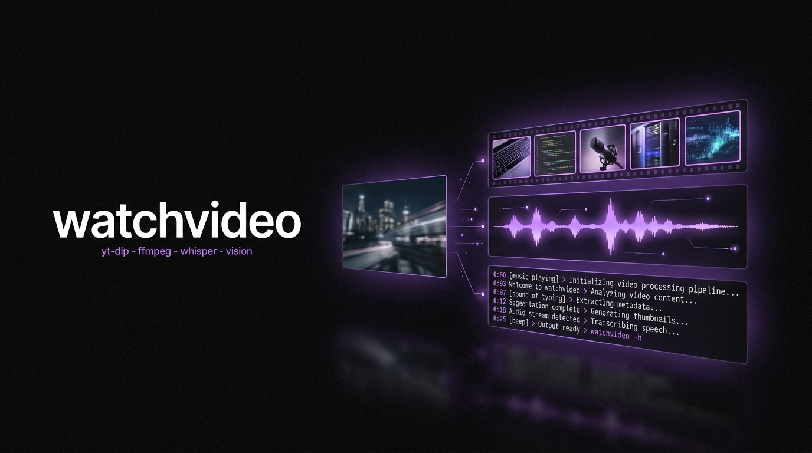

<p align="center">
  
</p>

# watchvideo

> **Local video analyzer** for [Claude Code](https://claude.ai/code). Paste a video URL. It downloads it, samples the frames, transcribes the audio on your own machine, reads what is on screen, researches the topic, and hands you a folder with the transcript, the hook breakdown, and whatever else you asked for.

<p>
  <a href="https://www.charlieautomates.com/"></a>
  <a href="https://www.npmjs.com/package/watchvideo"></a>
  <a href="https://www.npmjs.com/package/watchvideo"></a>
  <a href="LICENSE"></a>
  <a href="https://github.com/charlesdove977/watchvideo/stargazers"></a>
</p>

watchvideo ships the **`watchvideo`** skill: one command that turns a video into something you can read, search, and steal from. It runs entirely on free local tooling, so a run costs nothing but CPU.

Built for creators, marketers, and anyone who studies video for a living and is tired of scrubbing a timeline with a notepad open.

---

## Why

An LLM cannot watch a video. So most "analyze this video" tools either read the title and guess, or send your video to a paid API and charge you per minute.

watchvideo does what a human analyst does, locally:

- **Gets the file.** `yt-dlp` pulls the video at 720p, plus the platform's own captions as a cross-check.
- **Looks at it.** `ffmpeg` samples frames and tiles them into contact sheets, 30 frames to an image. Claude reads those sheets directly. A 10-minute video at 1 frame per second is 600 loose files and fits in nothing; the same 600 frames tiled is 20 images.
- **Listens to it.** `ffmpeg` extracts 16 kHz mono audio and local Whisper transcribes it, with real segment timestamps. Nothing leaves the machine.
- **Separates the two hooks.** What the video *says* in the first three seconds and what it *shows* are different signals, and the mismatch between them is usually the finding.
- **Checks the topic.** It searches the web around the video's actual claim, including a deliberate counter-search, and links its sources.

---

## How it works

```
yt-dlp   → get the file
ffmpeg   → extract frames  (visual)
ffmpeg   → extract audio   (16 kHz mono wav)
whisper  → audio to text   (spoken)
vision   → read the frames (your Claude Code session)
```

Then three questions, always asked before anything downloads:

1. **Which mode?** — `hook`, `condensed`, or `forensic`. See below.
2. **Which video(s)?** — one URL, several URLs, or a local file. Multiple videos are one run.
3. **Anything particular you want out of this run?** — asked **every run**. Answer it and you get an extra file built exactly for that ask. Say "standard" and you get the two defaults.

---

## The three modes

Frame density is the only real variable in a tool like this, so it is the thing you pick.

| Mode | Window | Sampling | Audio | Best for |
| --- | --- | --- | --- | --- |
| **`hook`** | **first 20 s only** | 1 frame/sec = 20 frames | trimmed to 0:20 | a whole competitor roster |
| **`condensed`** *(default)* | whole video | 1 frame / 3 s | full | one reel, or the shape of a longform |
| **`forensic`** | whole video | 1 frame / sec | full | frame-by-frame teardown of one short |

**Sheets per video**, measured (30 frames per sheet, cells stay 304px wide so burned-in captions remain readable):

| Duration | `hook` | `condensed` | `forensic` |
| --- | --- | --- | --- |
| 45 s reel | 1 | 1 | 2 |
| 3 min | 1 | 2 | 6 |
| 10 min | 1 | 7 | 20 |
| 40 min | 1 | 27 | 80 |

`hook` mode is flat at **one image per video no matter how long it is**, because it stops at 0:20 and trims the audio to match. Fifteen competitor reels is fifteen images and a couple of minutes of Whisper. That is what makes studying a roster practical instead of theoretical.

**The 15-sheet gate.** `ffprobe` gives the duration before a single frame is cut, so the cost is always known up front. If a run would exceed 15 sheets, watchvideo stops and shows you the real math with the cheaper option, instead of silently eating your context:

```
A 40 minute video in forensic mode is 2,400 frames, 80 sheets.
That will not fit in one context window.
  condensed  →  27 sheets
  hook       →  1 sheet
Which do you want?
```

**Modes change the report, not just the frames.** `hook` mode never saw past 0:20, so it drops the beat sheet, the CTA timestamp, and the topic research rather than inventing them, and instead writes a **hook scoreboard**: every video in the run as a row, with the verbatim spoken hook, hook type, visual type, and alignment verdict. `forensic` mode adds a measured edit-rhythm section, which is impossible at lower density. Every run stamps what it actually sampled:

```
Sampled: 45 frames at 1 per second, covering the full duration · 2 sheets · 45 of 1,350 frames seen (3.3%)
```

---

## What you get out

```
video-analytics/2026-08-18-how-i-automate-outreach/
├── transcript.md          ← the link + full transcript + timed segments, per video
├── analysis.md            ← spoken hook, visual hook, format, topic, beat sheet, web research
├── hook-rewrites.md       ← only when you asked for something in question 2
├── media/                 ← the downloaded mp4(s)
├── audio/                 ← 16 kHz mono wav(s), trimmed to 20 s in hook mode
└── frames/                ← contact sheets: 1 in hook mode, numbered otherwise
```

**`transcript.md`** keeps the words and the source link in the same file, so a transcript is never orphaned from the video it came from.

**`analysis.md`** is the breakdown:

| Section | What it holds |
| --- | --- |
| Spoken hook | the first sentence, quoted verbatim, with its real timestamp and hook type |
| Visual hook | what is on screen at t=0, on-screen text verbatim, what changes by t=5 |
| Hook alignment | `aligned` / `visual_carries` / `verbal_carries` / `mismatched` / `both_weak` |
| Format | primary format + modifiers, cut rhythm, where the CTA lands |
| Topic | one specific searchable topic line + the subtopics actually covered |
| Beat sheet | hook / setup / body / proof / CTA, built from measured Whisper timestamps |
| Topic research | state of play, claim check, what it leaves out, linked sources |

**The third file** is yours. Ask for hook rewrites, a claims audit, a shot list, a comparison against your own video, a list of every tool mentioned — it becomes its own named markdown file in the same folder.

---

## Install

### Option 1 — `npx` (recommended)

```bash
npx watchvideo install
```

Installs the skill to `~/.claude/skills/watchvideo/`. Run again with `update` after a package upgrade:

```bash
npm view watchvideo version          # check the latest published version
npx watchvideo@latest update         # refresh in place
```

### Option 2 — Global install

```bash
npm install -g watchvideo
watchvideo install
```

### Option 3 — Install directly from GitHub

```bash
npx github:charlesdove977/watchvideo install
npx github:charlesdove977/watchvideo install --with-commands
```

### Project-scoped install (per repo)

```bash
cd ~/path/to/project
npx watchvideo install --project
```

### Install a slash command stub

The `/watchvideo` command is exposed by the skill itself. To also drop an explicit command stub in `~/.claude/commands/`, add `--with-commands`:

```bash
npx watchvideo install --with-commands
```

### Uninstall

```bash
npx watchvideo uninstall
npx watchvideo uninstall --with-commands
```

---

## Requirements

Three local binaries, all free, all one-time:

```bash
brew install yt-dlp ffmpeg        # macOS
pip install -U openai-whisper
```

Check them any time:

```bash
npx watchvideo doctor
```

```
watchvideo v0.2.2 — dependency check

  OK       yt-dlp
  OK       ffmpeg
  OK       ffprobe
  OK       openai-whisper

All good. Run /watchvideo inside Claude Code.
```

| Dependency | Needed for | If missing |
| --- | --- | --- |
| `yt-dlp` | downloading from a URL | skip it if you only analyze local files |
| `ffmpeg` + `ffprobe` | frames and audio | required — there is no analysis without them |
| `openai-whisper` | the transcript | required for spoken content |

No API key. No MCP server. No account. Whisper runs on your CPU; the vision read runs inside the Claude Code session you already have open.

---

## Usage

Inside an active Claude Code session:

```
/watchvideo
```

or straight to the point:

```
/watchvideo https://www.youtube.com/watch?v=...
```

It asks the three questions, then runs the pipeline and reports back with the folder path and a one-line summary per video. The full transcript goes to the file, not to your chat window.

Studying a batch is the same command:

```
/watchvideo hook mode on these five: <url> <url> <url> <url> <url>
```

Five images, five transcripts of the first 20 seconds, and one scoreboard comparing all five hooks side by side.

### Whisper model sizes

| Model | Speed | Use when |
| --- | --- | --- |
| `tiny.en` | fastest | throwaway gist of a long video |
| `base.en` | default | every normal run |
| `small.en` | ~3× slower | accents, heavy jargon, or you asked for accuracy |

---

## CLI reference

```
watchvideo <command> [flags]

Commands:
  install         Install the watchvideo skill
  update          Reinstall (overwrites existing)
  uninstall       Remove the skill
  doctor          Check yt-dlp / ffmpeg / whisper are available
  where           Print the install path
  --help, -h      Show help
  --version, -v   Show version

Flags:
  --project           Use ./.claude/ instead of ~/.claude/
  --with-commands     Also install a slash command stub
  --update, --force   Overwrite an existing install (implied by `update`)
```

---

## What gets installed

```
~/.claude/skills/watchvideo/
├── SKILL.md
├── tasks/
│   └── watch.md                 ← the full analysis run
├── frameworks/
│   ├── media-pipeline.md        ← the three modes, tile geometry, sheet math, failure tables
│   ├── hook-analysis.md         ← spoken + visual hook taxonomy, format classification
│   └── topic-research.md        ← web research method, source ranking, counter-search
├── templates/
│   ├── transcript-md.md         ← the transcript file
│   ├── analysis-md.md           ← the breakdown file
│   └── custom-request-md.md     ← the third file, when you ask for one
└── context/
    └── output-paths.md          ← where run folders get written
```

Run folders are written to your *project*, never into the skill folder.

---

## Why contact sheets

Thirty frames per image, not one image per frame. A 10-minute video at 1 frame per second is 600 loose JPEGs, which fits in no context window; the same 600 frames tiled is 20 images. In `hook` mode it collapses further: 20 frames, one image, per video, forever.

That single decision is the difference between analyzing a clip and analyzing a roster. Fifteen competitor reels in `hook` mode is fifteen images and one scoreboard. The same fifteen reels at 1 fps as loose files is roughly 675 images and an immediate dead end.

The cell size is the other half of it. Cells stay 304px wide (250px for vertical), which is enough to read burned-in captions verbatim. Pack more frames per sheet and you save images but lose the on-screen text, and the on-screen text is usually where the hook actually lives.

---

## Honest limits

- **It samples, it does not watch every frame.** Even `forensic` mode is 1 frame per second on 30fps footage, so it sees 1 frame in 30. Every run stamps the real percentage in `analysis.md` rather than claiming it watched the whole thing.
- **`hook` mode only knows the first 20 seconds.** Not the middle, not the CTA, not the payoff. It says so in the file instead of guessing, and skips the topic research entirely.
- **It cannot tell you why a video performed.** Retention, traffic source, and audience data are not in the file. The skill says `unverified` rather than guessing at them.
- **Auto-captions are a cross-check, not the transcript.** Whisper output is the record.
- **YouTube blocks some downloads.** Keep `yt-dlp` current (`pip install -U yt-dlp`, or the nightly channel). When a video 403s anyway, the skill says so and falls back to the captions rather than pretending it watched the file.
- **Public video only.** No login walls, no age-gate workarounds, no paywalls. Analyze, do not repost.

---

## FAQ

**Does anything leave my machine?**
The download, and the web searches for the topic research. The audio and the video never go to a transcription API; Whisper runs locally.

**Does it work on Instagram / TikTok / X?**
Wherever `yt-dlp` has a working extractor, yes. Public posts only.

**Can I analyze a local file?**
Yes. Give it an absolute path instead of a URL. `yt-dlp` is not needed for that path.

**How long does a run take?**
Most of it is Whisper. A 10-minute video on `base.en` is a couple of minutes on a modern laptop. The download and frame extraction are seconds.

**Can I customize the skill after installing?**
Yes, the installed files are yours. The next `update` overwrites them, so fork the repo if you are making meaningful changes.

---

## Related projects

- **[Work with Charlie](https://www.charlieautomates.com/)** — find the one bottleneck capping your revenue, then get it built. Consulting, teaching, or done-for-you.
- **[advertising-ops](https://github.com/charlesdove977/advertising-ops)** — CMO in a box: scrape long-running winning ads, tear down the creative, generate new variations.
- **[procedure-ops](https://github.com/charlesdove977/procedure-ops)** — COO in a box: build ironclad SOPs from interviews, recordings, or drafts.

---

## Contributing

Issues + PRs welcome at [github.com/charlesdove977/watchvideo](https://github.com/charlesdove977/watchvideo).

1. Fork + clone
2. Edit files under `skill/`
3. Smoke test with `npx . install --project` inside a scratch directory
4. PR against `main`

When the package version bumps, the skill version inside `skill/SKILL.md` should match.

---

## License

MIT — see [LICENSE](LICENSE).
